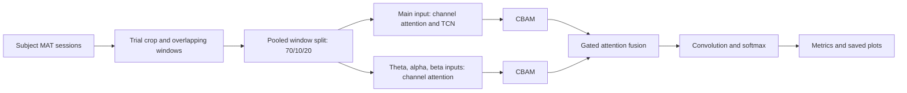

# MBAN-AFBF: Motor Imagery EEG Classification

**Motor imagery classification with multi-branch attention and adaptive feature fusion.**

This project classifies EEG recordings associated with imagined movements using BCI Competition IV datasets 2a and 2b. The implementation includes attention, temporal convolutional networks (TCN), convolutional block attention modules (CBAM), and feature fusion. Each subject is processed independently.

[Model and notebook guide](#model-and-notebook-guide) · [Data](#data) · [Method overview](#method-and-interpretation) · [Research context](#research-context)

## Project at a glance

| Area | Included work |
|---|---|
| Task | Subject-specific motor imagery EEG classification |
| IV-2a | 22 EEG channels, four classes, main model and seven ablations |
| IV-2b | Three EEG channels, two classes, dataset-specific main model |
| Framework | TensorFlow with legacy Keras through `tf-keras` |
| Source | All research notebook for Subject 1, with existing output |
| Outputs | Metrics, predictions, weights, confusion matrices, learning curves, and t-SNE plots |

## Repository structure

```text
get_data.py           MATLAB session loaders
preprocessing.py      Windows, label expansion, splits, and band filters
model.py              IV-2a model and seven supplied ablations
model_2b.py           IV-2b model and dataset-specific layers
train.py              Training and subject loop
test.py               Saved-weight evaluation entry point
evaluate.py           Metrics and split-wise plotting orchestration
plots.py              Confusion matrices, learning curves, and t-SNE views
notebooks/            Nine research notebooks without saved outputs
requirements.txt      Pinned Python dependencies
```

## Model and notebook guide

Start with the main notebook for the dataset of interest; the seven IV-2a ablations document variations of that model.

| Dataset / variant | Notebook | Model builder |
|---|---|---|
| IV-2a / `full` | [Main IV-2a notebook](notebooks/s1-bci-iv-2a.ipynb) | [model.py](model.py): `build_full` |
| IV-2a / `main-only` | [Main branch only](notebooks/s1-bci-iv-2a-main-only.ipynb) | [model.py](model.py): `build_main_only` |
| IV-2a / `subbands-only` | [Subbands only](notebooks/s1-bci-iv-2a-subbands-only.ipynb) | [model.py](model.py): `build_subbands_only` |
| IV-2a / `no-theta` | [Without theta](notebooks/s1-bci-iv-2a-no-theta.ipynb) | [model.py](model.py): `build_no_theta` |
| IV-2a / `no-alpha` | [Without alpha](notebooks/s1-bci-iv-2a-no-alpha.ipynb) | [model.py](model.py): `build_no_alpha` |
| IV-2a / `no-beta` | [Without beta](notebooks/s1-bci-iv-2a-no-beta.ipynb) | [model.py](model.py): `build_no_beta` |
| IV-2a / `additive` | [Additive fusion](notebooks/s1-bci-iv-2a-additive.ipynb) | [model.py](model.py): `build_additive` |
| IV-2a / `concatenation` | [Concatenation fusion](notebooks/s1-bci-iv-2a-concatenation.ipynb) | [model.py](model.py): `build_concatenation` |
| IV-2b / `full` | [Main IV-2b notebook](notebooks/s1-bci-iv-2b.ipynb) | [model_2b.py](model_2b.py): `build_full` |

## Setup

Clone or download `mban-afbf-mi-eeg`, open a terminal in the repository folder, and use Python 3.11 or 3.12 in a virtual environment:

```bash
python -m venv .venv
# Windows PowerShell:
.venv\Scripts\Activate.ps1
# Linux/macOS instead: source .venv/bin/activate
python -m pip install -r requirements.txt
```

The modules enable `TF_USE_LEGACY_KERAS=1` with `tf-keras` 2.16 to retain the notebook's TensorFlow variable tracking and layer semantics. In an interactive Python session, set this before importing TensorFlow. GPU execution depends on your TensorFlow/platform installation; CPU execution is supported. Full training is computationally expensive. Preprocessing materializes overlapping windows and multiple bands in memory, so allow several GB of available RAM per subject.

## Data

Obtain the MATLAB versions of BCI Competition IV-2a and IV-2b from the [BNCI data repository](https://bnci-horizon-2020.eu/database/data-sets). The loader expects the session-level `data` MATLAB structure used in the supplied notebooks, including labels and artifact flags.

Select **001-2014** for IV-2a and **004-2014** for IV-2b.

Datasets are not committed. Pass the dataset folder with `--data-dir`. Both layouts work:

```text
data/2a/Training/A01T.mat ... A09T.mat
data/2a/Evaluation/A01E.mat ... A09E.mat
# Or place all A??T.mat and A??E.mat files directly in data/2a/.
# For 2b, use B01T.mat ... B09T.mat and B01E.mat ... B09E.mat.
```

Only files for the subjects you request are required. IV-2a uses 22 channels and four classes; IV-2b uses three channels and two classes. The loaders preserve notebook artifact handling: all trials for 2a, artifact-free trials for 2b.

## Train one or multiple subjects

```bash
python train.py --dataset 2a --data-dir data/2a --subjects 1
python train.py --dataset 2a --data-dir data/2a --subjects 1 2 3 4 5 6 7 8 9
python train.py --dataset 2b --data-dir data/2b --subjects 1 2 3
```

The default is Subject 1. The loop builds and trains a fresh model for each subject; it does not pool subjects. Seeds reset to 42 for each run. The original fit calls specify 1320 epochs for 2a and 1200 for 2b, with batch size 64 and Adam at 0.0001. To check your installation with a short run:

```bash
python train.py --dataset 2a --data-dir data/2a --subjects 1 --epochs 1 --no-tsne --output-dir results-smoke
```

A one-epoch run still processes all windows and is not a benchmark result. An existing subject output directory is rejected to prevent accidental replacement; use another `--output-dir` for a new run.

The supplied IV-2a ablations are selectable with `--variant`: `full`, `main-only`, `subbands-only`, `no-theta`, `no-alpha`, `no-beta`, `additive`, `concatenation`.

```bash
python train.py --data-dir data/2a --subjects 1 2 --variant no-alpha
```

IV-2b supports `full` only, matching the supplied material.

## Saved outputs and testing

Each run writes to `results/<dataset>/<variant>/subject_XX/`:

- Configuration, model summary, completed epochs and training duration.
- Final weights and training history; best validation weights where notebook callbacks were enabled.
- Train, validation and test metrics, classification reports, labels and prediction probabilities.
- Count and percentage confusion matrices, learning curves and t-SNE plots of output probabilities.

Metrics include accuracy, weighted precision/recall/F1 and Cohen's kappa. The t-SNE plots use class probabilities, as in the notebooks, rather than hidden-layer features. Use `--no-tsne` to omit them. Add `--show-plots` to training or testing to display saved figures interactively; the default saves and closes them. For a headless server, set `MPLBACKEND=Agg`.

### Plot coverage from the notebooks

All plotting functions live in `plots.py`. `train.py` calls `plot_history` and
`evaluate.py` calls the split-level functions automatically for each subject.

| Notebook plot | Function | Saved output |
| --- | --- | --- |
| Train/validation accuracy and loss (two panels) | `plot_history` | `learning_curves.png` |
| Count confusion matrices (Train/Val/Test) | `plot_confusion_matrix` | `{split}_confusion_matrix.png` |
| Row-normalized confusion matrices with `%` cell labels | `plot_confusion_matrix_percent` | `{split}_confusion_matrix_percent.png` |
| Named-class t-SNE for each split | `plot_and_save_tsne` | `{split}_tsne.png` |
| IV-2a numeric-class t-SNE overview, also in all ablations | `plot_and_save_tsne` | `{split}_tsne_classes.png` |

`{split}` is `train`, `val` or `test`. A default complete training run produces
**13 PNGs for IV-2a** (including ablations), or **10 PNGs for IV-2b**.
The original IV-2a notebooks created the numeric-class overview without saving it;
the modular version saves both views from the same embedding. IV-2b contains only
the named-class view. Embeddings are also saved as `{split}_tsne.npy`.
Splits with fewer than 31 samples issue an explicit warning and skip
t-SNE because the original perplexity requires more samples. Percentage matrices
retain the notebook's zero-row handling and one-decimal `%` annotations.

`test.py` generates plots for the test split only; learning curves are produced
by training, where the history is available. Plot images are generated when you
run the pipeline.

```bash
python test.py --data-dir data/2a --run-dir results/2a/full/subject_01
python test.py --data-dir data/2b --run-dir results/2b/full/subject_01 --weights best
```

Testing recreates the deterministic notebook split from the same data and writes into `test_final/` or `test_best/` inside the run. The default evaluates final-epoch weights, matching notebook evaluation. Repeated testing replaces that test output. Best weights exist only for IV-2a ablations and IV-2b.

## Method and interpretation



### Data Processing and Dataset Splitting

The training and evaluation sessions are segmented into trials and overlapping windows before being combined into a single dataset. The resulting windows are then stratified into training (70%), validation (10%), and test (20%) subsets.

## Research context

The project documentation identifies the manuscript as *MBAN-AFBF: A Multi-Branch Gated Attention Network for Adaptive Spatial-Temporal-Spectral Fusion in Motor Imagery EEG Decoding*, by Uddeshay Anand, Kusum Kumari Bharti and Mohd Sameer.

The recorded manuscript-reported mean accuracies are **88.90% on IV-2a** and **80.44% on IV-2b**. The manuscript and supporting benchmark result files are not included in this copy, and no public link to the manuscript has been provided, as it is still under consideration by the journal Signal, Image and Video Processing (Springer Nature).
